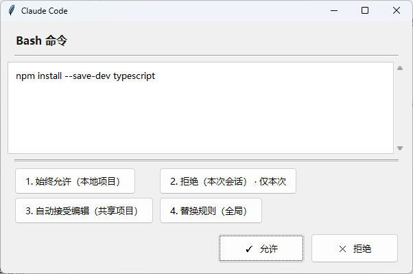
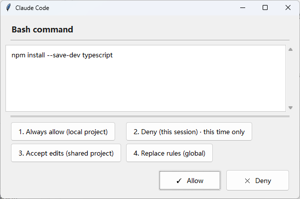
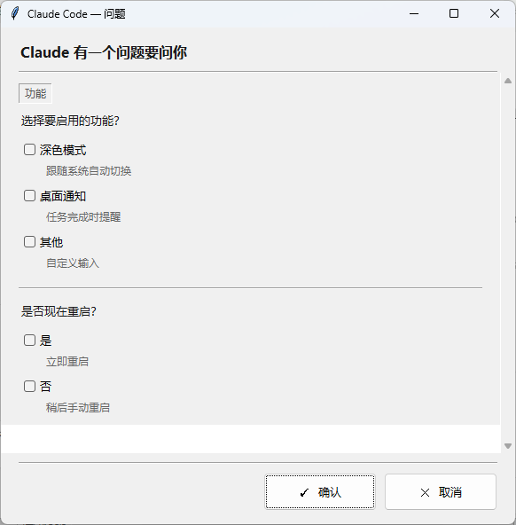
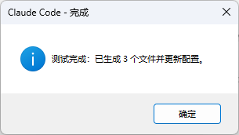
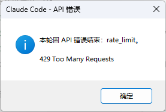
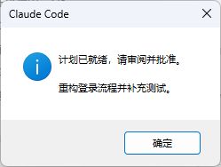
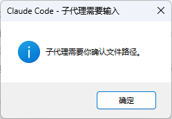

# Claude Code Notify

[](https://github.com/BaixuanZhu/claude-code-hooks/actions/workflows/tests.yml)

Native GUI dialogs and notifications for Claude Code — permission prompts, questions, turn completion, API failures, and subagent events. Zero dependencies beyond Python 3.10+ and tkinter.

Cross-platform (Windows / macOS / Linux). Requires Claude Code **2.1.300+**.

## Demo

Dialogs follow the system language (Chinese or English); set `CLAUDE_GUI_HOOKS_LANG=en|zh` to override. Captured on Windows 11 with a Chinese UI.

| Hook | Screenshot |
|------|------------|
| Permission Request — Chinese |  |
| Permission Request — English |  |
| Ask User Question |  |
| Stop Notify |  |
| API Failure |  |
| Exit Plan Mode |  |
| Agent Events |  |

## Features

| Hook | Event | What it does |
|------|-------|--------------|
| **Permission Request** | `PermissionRequest` | Allow/Deny dialog with scope-aware suggestion buttons (session / project / global, localized labels) |
| **Ask User Question** | `PreToolUse` → `AskUserQuestion` | Native option dialog — single/multi select plus multi-line free-text "Other" input |
| **Stop Notify** | `Stop` | Auto-closing messagebox when Claude finishes (8s); says so when background work keeps running |
| **Plan Ready** | `PermissionRequest` → `ExitPlanMode` | Topmost messagebox when a plan is ready (auto-closes after 25s) |
| **API Failure** | `StopFailure` | Messagebox when a turn ends due to rate limit, auth, or other API errors |
| **Agent Events** | `Notification` | Messagebox when a subagent needs input or finishes |

- **Zero dependencies** — Python 3.10+ + tkinter, nothing else
- **Bilingual UI** — follows the system language (Chinese or English); `CLAUDE_GUI_HOOKS_LANG=zh|en` overrides it
- **One dialog at a time** — permission/question dialogs queue behind an open one; background notifications are skipped while a dialog is up
- **Async notifications** — Stop, StopFailure, plan, and agent dialogs run in the background; they never delay Claude
- **Headless-safe** — dialogs are skipped in CI or with `CLAUDE_GUI_HOOKS_DISABLE=1`, leaving Claude Code's normal permission flow untouched
- **Never blocks on failure** — broken hooks fall through (`onFailure: "continue"`) instead of blocking a tool call
- **Native styling** — platform ttk themes (vista on Windows, aqua on macOS, clam on Linux) and CJK-aware fonts
- **Keyboard shortcuts** — Enter to Allow, Escape to Deny, number keys for suggestions, Ctrl+Enter to confirm in text areas
- **No console flash** — uses `pythonw` on Windows

## Install

### Plugin install (recommended)

Requires Claude Code v2.1.300+ with plugin support.

**Step 1** — Add the marketplace:

```bash
claude plugin marketplace add BaixuanZhu/claude-code-hooks
```

**Step 2** — Install the plugin:

```bash
claude plugin install desktop-dialogs@claude-code-hooks
```

Or use the interactive `/plugin` command to browse and enable. No `settings.json` modification needed — hooks are bundled in the plugin.

**Update:**

```bash
claude plugin update desktop-dialogs
```

**Uninstall:**

```bash
claude plugin uninstall desktop-dialogs
```

**Upgrading from 0.2.x** — the plugin was renamed, so reinstall once:

```bash
claude plugin uninstall claude-code-hooks
claude plugin install desktop-dialogs@claude-code-hooks
```

To test locally before publishing:

```bash
git clone https://github.com/BaixuanZhu/claude-code-hooks.git
claude plugin marketplace add ./claude-code-hooks
claude plugin install desktop-dialogs@claude-code-hooks
```

> On Windows the plugin uses a shell-form command, which needs Git for Windows (Git Bash). Without Git Bash the hooks degrade to "no dialog, no blocking" — use the PowerShell installer below to get exec-form commands that need no shell.

### PowerShell one-liner (Windows)

```powershell
iwr https://raw.githubusercontent.com/BaixuanZhu/claude-code-hooks/main/install.ps1 -UseBasicParsing | iex
```

Downloads all 6 scripts and merges exec-form entries into `~/.claude/settings.json`. Idempotent — safe to re-run, and only replaces entries owned by this installer.

### AI-assisted install

Share this URL with your Claude Code:

```
https://raw.githubusercontent.com/BaixuanZhu/claude-code-hooks/main/skills/SKILL.md
```

The AI reads `SKILL.md` and installs everything automatically.

### Manual

1. Clone the repo
2. Copy `hooks/*.py` (6 files, including the shared `hook_common.py`) into `~/.claude/hooks/scripts/` (create the folder if needed)
3. Add to `~/.claude/settings.json`:

Set `<PYTHON>` to `pythonw` on Windows or `python3` on macOS/Linux, and `<SCRIPTS_DIR>` to the **absolute** scripts path (for example `C:/Users/you/.claude/hooks/scripts`). Exec form (`command` + `args`) needs no shell, so it works even when Windows PowerShell 5.1 is the default shell.

```json
{
  "hooks": {
    "PermissionRequest": [
      {
        "matcher": "^(Bash|PowerShell|Edit|Write|Read|Glob|Grep|Agent|Workflow|WebFetch|WebSearch|NotebookEdit|mcp__.*)$",
        "hooks": [
          {
            "type": "command",
            "command": "<PYTHON>",
            "args": ["<SCRIPTS_DIR>/permission_request.py"],
            "onFailure": "continue"
          }
        ]
      },
      {
        "matcher": "^ExitPlanMode$",
        "hooks": [
          {
            "type": "command",
            "command": "<PYTHON>",
            "args": ["<SCRIPTS_DIR>/exit_plan_mode_notify.py"],
            "async": true,
            "onFailure": "continue"
          }
        ]
      }
    ],
    "PreToolUse": [
      {
        "matcher": "^AskUserQuestion$",
        "hooks": [
          {
            "type": "command",
            "command": "<PYTHON>",
            "args": ["<SCRIPTS_DIR>/ask_user_question.py"],
            "onFailure": "continue"
          }
        ]
      }
    ],
    "Stop": [
      {
        "hooks": [
          {
            "type": "command",
            "command": "<PYTHON>",
            "args": ["<SCRIPTS_DIR>/stop_notify.py"],
            "async": true
          }
        ]
      }
    ],
    "StopFailure": [
      {
        "hooks": [
          {
            "type": "command",
            "command": "<PYTHON>",
            "args": ["<SCRIPTS_DIR>/stop_notify.py"],
            "async": true
          }
        ]
      }
    ],
    "Notification": [
      {
        "matcher": "agent_needs_input|agent_completed",
        "hooks": [
          {
            "type": "command",
            "command": "<PYTHON>",
            "args": ["<SCRIPTS_DIR>/notification_notify.py"],
            "async": true
          }
        ]
      }
    ]
  }
}
```

4. Restart Claude Code

## Platform requirements

| Platform | Python | tkinter | Interpreters |
|----------|--------|---------|--------------|
| Windows | 3.10+ | Built-in | `pythonw` for no console flash |
| macOS | 3.10+ | `brew install python-tk` | `python3` |
| Linux | 3.10+ | `sudo apt install python3-tk` | `python3` |

## Behavior notes

- **Permission suggestions** — deny suggestions are marked "this time only" because Claude Code's `updatedPermissions` is allow-only; a deny rule cannot be persisted from a dialog. Use `/permissions` for permanent deny rules.
- **Language** — `CLAUDE_GUI_HOOKS_LANG=zh|en` wins; otherwise a real locale in `LC_ALL`/`LC_MESSAGES`/`LANG` (C/POSIX placeholders are ignored), otherwise the Windows UI language, otherwise English. The deny message sent back to Claude stays English.
- **Serialized dialogs** — all dialogs share a cross-process lock in the temp directory. Permission and question dialogs wait up to 60s for the current dialog to close, then show anyway; notification popups are dropped while another dialog is open. A crashed hook cannot leave a stale lock because the OS releases it.
- **Headless runs** — `CI` or `CLAUDE_GUI_HOOKS_DISABLE=1` makes every hook exit silently, so `-p` runs and CI pipelines never pop a dialog.
- **Windows without Git Bash (plugin install)** — hooks fail to start and `onFailure: "continue"` lets the tool call proceed without a dialog. The PowerShell installer avoids this.
- **Async hooks** — Stop/StopFailure/Notification/plan dialogs are fire-and-forget. In `-p` runs, Claude Code terminates background hooks at teardown, so the dialog may not appear.
- **Notification types** — only `agent_needs_input` and `agent_completed` are shown. `idle_prompt` and `permission_prompt` are intentionally ignored because the Stop and PermissionRequest dialogs already cover them.
- **Multi-select answers** — returned as label arrays, which also avoids ambiguity when a label contains a comma.

## Limitations

- **tkinter required** — most Python installations include it; Linux may need `python3-tk`
- **Native widget themes** — vista/winnative on Windows, aqua on macOS, clam on Linux; no custom color scheme
- **DPI awareness** — optimized for Windows; macOS/Linux use system defaults
- **Two languages** — Chinese and English; other locales fall back to English

## License

[MIT](LICENSE)
